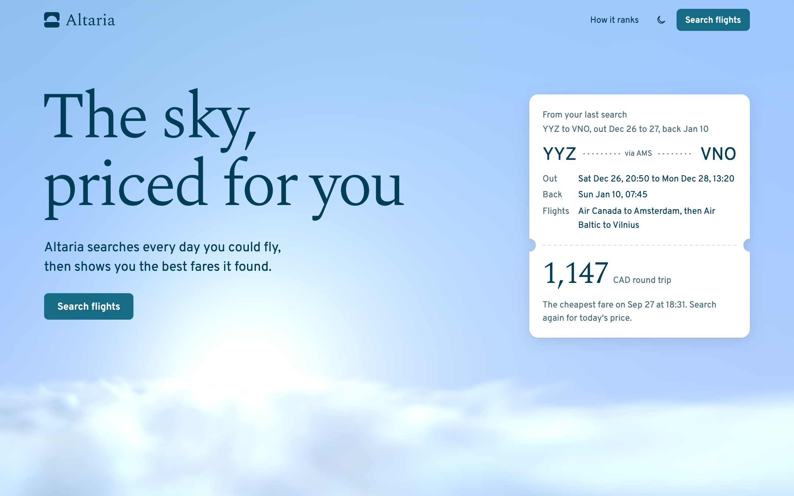
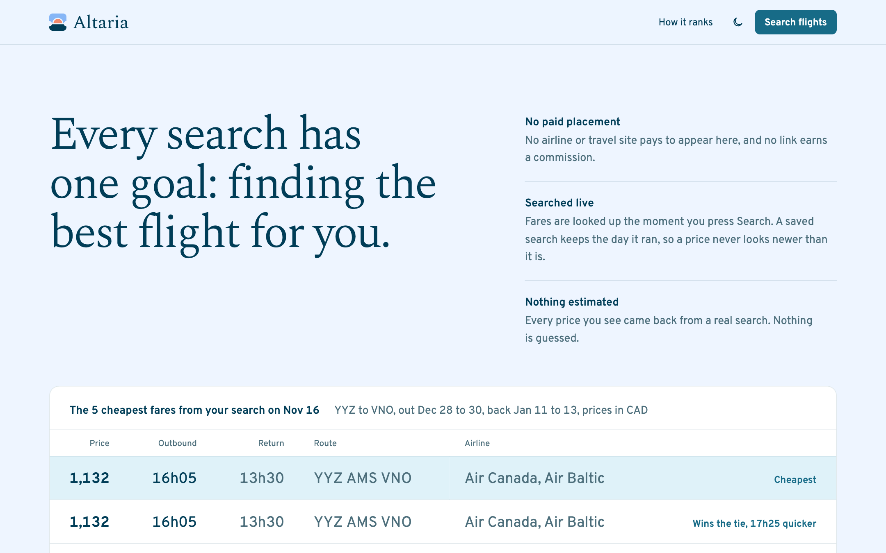
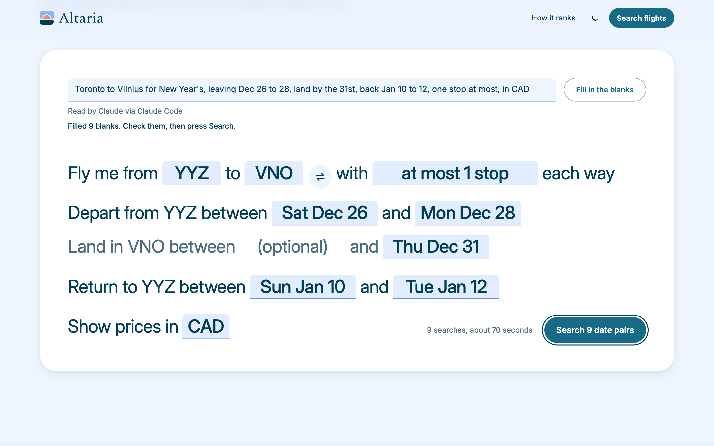
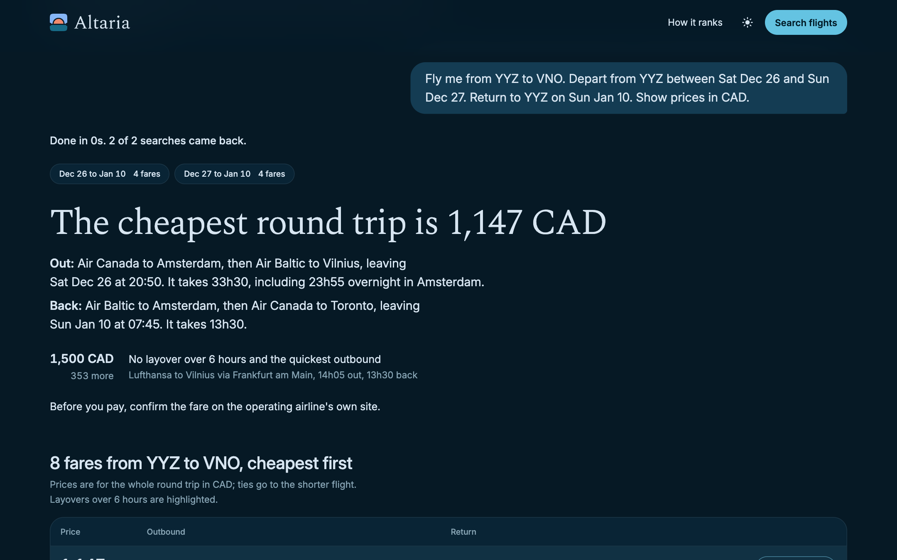
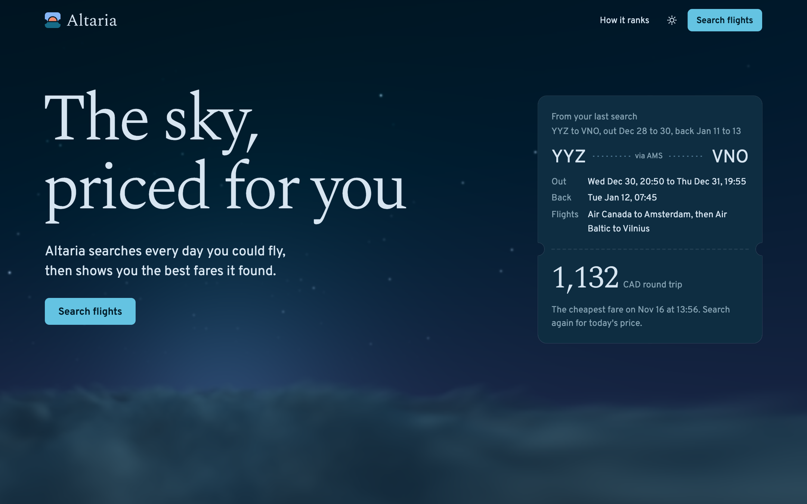

# Altaria

A round-trip flight search, priced for you. It prices every pair of dates you give it and sorts round trips by price, then by flight time. Nothing is sponsored, and nothing is estimated: every fare on the page came back from a search.

Try it at [altaria.macwell.workers.dev](https://altaria.macwell.workers.dev), or run it yourself.



## What it does

- **Searches a window of dates, not one date.** Three possible departure days and three return days are nine searches, each run live against Google Flights. The command line can also search ITA Matrix, the fare engine airlines price with.
- **Ranks by price, then flight time.** There is no paid slot and no affiliate link. A tie on price goes to the shorter trip.
- **Shows the whole trip.** Each fare lists every flight and layover both ways, and marks layovers over six hours.
- **Takes a trip in plain English.** With a model set up, "Toronto to Vilnius for New Year's, back mid January, one stop at most" fills in the search for you to check. The model never sees or produces a price.

| | |
|---|---|
|  |  |
|  |  |

The fares in these screenshots come from one real saved search, replayed, and the trip box's answer is a canned one, so taking the screenshots queried neither Google nor a model.

## Run it

Built with Python 3.14 and Node 26.

```
python3 -m venv .venv && .venv/bin/pip install -r requirements.txt
.venv/bin/python -m playwright install chromium
cd web && npm install && npm run build && cd ..
.venv/bin/python server.py
```

Then open http://localhost:8000. The server listens on 127.0.0.1 only.

The public version is a Cloudflare Worker in `worker/`. Build `web/` first, then from `worker/`:

```
npx wrangler@4 dev       # http://localhost:8787
npx wrangler@4 deploy
```

Its trip reader uses Gemini and needs a `GEMINI_API_KEY`: in `worker/.dev.vars` for `wrangler dev`, and set with `npx wrangler@4 secret put GEMINI_API_KEY` once deployed.

From the command line, with both sources:

```
.venv/bin/python search.py --from YYZ --to VNO --out 2026-12-28..2026-12-30 \
  --ret 2027-01-10..2027-01-15 --arrive-between 2026-12-30,2026-12-31 --source both
```

## How it works

```
search.py   fetch fares (Google Flights, ITA Matrix), normalise, convert currency, rank, save
server.py   standard-library HTTP server: serves the built site, streams each search as Server-Sent Events
ai.py       the trip reader: a model fills in the form's fields, and every value is checked before the page sees it
web/        the site: React and Vite in plain JavaScript, plain CSS, no UI kit
worker/     the public site: a Cloudflare Worker serving the same page and API, Google only, with daily caps
```

A search starts in the form's submit handler. The server runs one date pair at a time and streams a plan, then progress for each pair, then the ranked rows. The page shows a segmented progress rail while it waits. Every run is saved, and the newest one feeds the fare pass in the hero and the ranking board.

The Worker runs on Cloudflare's free plan, which allows each request 10ms of CPU and 50 subrequests. So it only checks the query and answers with the plan, and the page runs the search itself, one Google request per call. `web/src/flights.js` is the JavaScript port of `search.py`'s Google side, and `worker/ai.js` ports `ai.py`'s checks. There the fare pass and the board show the visitor's own last search, kept in their browser.

## Design

The direction is calm, exact and candid. The page belongs to two places: the window seat above the clouds, and the airport's own information, which is timetables, boarding passes and departure boards.

- **Type.** Spectral Light for display lines only and Overpass, the lettering of wayfinding signs, for everything else at two weights, all self-hosted with metric-matched fallback faces so the swap moves nothing. The scale is in rem. Flight numbers get a slashed zero, because LO46 puts a letter O beside a zero.
- **Colour.** One ice and teal ramp in custom properties, light and dark. The richness is kept for three places: the sky, the fare pass and the ranking board.
- **Signature.** A real value flips into place like a departure board character when it arrives: the pass's codes and fare, an airport when picked, a search's cheapest price, the board's rows. The final text is in the page from the first paint, so the accessible name is always right and nothing shifts.
- **Scroll.** [Lenis](https://github.com/darkroomengineering/lenis) smooths wheel and trackpad scrolling and drives the hero's scroll scene. Touch, the keyboard and find-in-page stay native, and `web/src/scroll.js` is the only scroll code in the app.
- **The sky.** Vanta's clouds, with a wake spliced into its shader: the clouds part along the pointer's path and show farmland by day and town lights by night. A still of the clouds' first frame is the sky from the first paint; three.js loads in its own chunk and takes over once the page has settled.
- **Stylesheet.** Cascade layers (`reset, tokens, base, components, sections, utilities`), one concern per file, in `web/src/styles/`.

## Accessibility and performance

- Everything works by keyboard with a visible focus ring, text pairs meet AA contrast, and the layout holds at a 24px default text size and at 360px wide.
- `prefers-reduced-motion` gets a still composition and native scrolling. `prefers-reduced-transparency` and `prefers-contrast: more` get a solid header.
- Measured in headless Chromium on the development Mac: layout shift from the font swap in the hero is 0.0000 at 1440px and 390px, and no frame takes longer than 25ms while scrolling the hero with the sky running.
- The main bundle is 92.4 kB gzipped and the stylesheet 19.3 kB. The sky's chunk (143 kB gzipped) is fetched after first paint.

## The trip reader

`POST /api/ai/trip` hands the text to a model and gets back values for the form's fields. `ai.py` then checks each one: airport codes against the airport list, currencies against the form's own list, and dates against the calendar and each other. Anything that fails is dropped with a reason. The page marks what was filled, says what is still open, and never starts the search itself.

Two providers sit behind one small interface, chosen with `ALTARIA_AI`:

- `ollama`: a local model server on port 11434. Tested against a stand-in server only.
- `claude`: the Claude Code CLI, signed in with your own subscription, run with no tools in an empty temporary folder.

Unset, it tries Ollama and then `claude` on PATH. With neither, the trip box is simply not on the page. The server only answers its own page, one call at a time, so another site open in the browser cannot spend your quota. The Claude route is for your own machine: Anthropic's terms do not allow serving other people through a personal subscription.

The public site reads trips with Gemini instead, under a daily cap.

## Tests

```
.venv/bin/python tests/test_search.py     parsers and filters, on real saved responses
.venv/bin/python tests/test_ai.py         field checks, both providers against stand-ins, the endpoints and their rejections
cd web && npm test && cd ..               33 unit tests on the page's plain modules, with Node's own runner
.venv/bin/python tests/test_site.py       the built site in headless Chromium, with a replayed run and a stand-in model
cd worker && npm test && cd ..            the Cloudflare version's search and trip reader, checked against the Python
```

`tests/test_site.py` covers the hero's fare, the board's order, a full search, the airport finder, the trip box, the theme toggle, reduced motion, keyboard reach and a 360px window. Build the site first.

## Known limits

- The public site shares one daily cap on searches and trip readings among all its visitors. Once the day's searches are used up, it says so instead of showing saved fares.
- The Google parser reads a private format by position and will break when that format changes. The Matrix source drives the real page in a headless browser and takes about 30 seconds per date pair, which is why the site uses Google only.
- The styled currency and stops lists need a recent Chromium. Safari and Firefox show their native lists.
- Before you pay, confirm the fare on the operating airline's own site.

## Credits

- Fares from Google Flights through [fast-flights](https://pypi.org/project/fast-flights/). Airports from [OurAirports](https://ourairports.com/), in the public domain.
- [Spectral](https://github.com/productiontype/Spectral) and [Overpass](https://github.com/RedHatOfficial/Overpass), both under the SIL Open Font License.
- The sky is by [Vanta.js](https://www.vantajs.com/), after Inigo Quilez's "Clouds" shader, licensed CC BY-NC-SA 3.0, so this project is non-commercial.
- The split-flap is rewritten from the technique in [React Bits](https://reactbits.dev)' SplitFlapText (MIT with a Commons Clause).
- The name is shared with a Pokémon. This project is not affiliated with Nintendo, Game Freak or The Pokémon Company.
